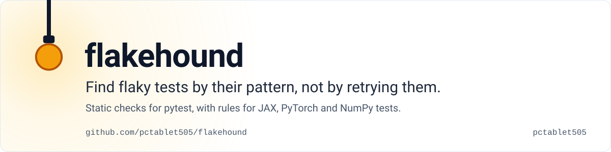

<a href="docs/rules.md">
<picture>
  <source media="(prefers-color-scheme: dark)" srcset="assets/hero-dark.svg">
  
</picture>
</a>

flakehound reads a pytest suite and flags the line that makes a test pass and fail on the same commit: a global
random seed, a set compared in order, a network call nobody mocked. Each finding says why it flakes and how to fix
it, and the scan runs none of your tests.

**[Run it on your tests →](#try-it)**

  

## What you get

```
tests/test_model.py:41:4: [G1/high] `np.random.seed(...)` mutates global RNG state; test outcomes now depend on execution order
    fix: use a local generator: `rng = np.random.default_rng(seed)` ...
tests/test_infer.py:88:8: [M3/advisory] `atol=1e-08` on a value derived from `model.predict(...)` is machine-precision tight; stochastic/float32 model outputs routinely disagree by more than this run-to-run
    fix: justify this bound or derive it from an observed distribution of repeated runs (FLEX FSE-21) ...
```

17 rules: 12 for any Python suite and 5 for ML tests (JAX, PyTorch, NumPy). One of the ML rules catches a tolerance
so tight that the test fails on noise. [Every rule, with a bad and a good example →](docs/rules.md)

## Is it for you?

For pytest suites that fail now and then for no clear reason, above all ML suites full of seeds and float
tolerances.

What it is not:

- **Not a retry plugin.** A retry hides a flaky test; flakehound points at the line that makes it flaky.
- **Not on PyPI yet.** Install it from this repository, as below.
- **Not history-based yet.** Scoring tests from their past runs is planned for v0.2; today the plugin prints a
  summary at the end of a run.
- **Not a service.** It runs on your machine, with no server and no account.

## Try it

```bash
pip install git+https://github.com/pctablet505/flakehound
flakehound scan tests/      # static scan: runs no tests
pytest --flakehound         # or as part of a pytest run
```

## How it works

Each rule is a small check on the syntax tree of your tests (`src/flakehound/rules/`), so a scan needs no test run
and no GPU. Rules are tuned in `pyproject.toml`:

```toml
[tool.flakehound]
fail_on = "high"          # high | medium | advisory | never
disable = ["G3"]
exclude = ["tests/legacy/*"]
ml_rules = true
```

## Go deeper

<details>
<summary><b>The 17 rules</b></summary>

| ID | Rule | ID | Rule |
|---|---|---|---|
| G1 | global-seed-mutation | G9 | hardcoded-tmp-paths |
| G2 | unordered-collection-compare | G10 | event-loop-misuse |
| G3 | sleep-in-test | G11 | leaked-threads-timers |
| G4 | naive-now | G12 | env-mutation |
| G5 | shared-state-fixture | M1 | unseeded-stochastic-assert |
| G6 | import-time-side-effects | M2 | jax-prngkey-reuse |
| G7 | unmocked-network | M3 | suspicious-tolerance |
| G8 | float-equality-without-tolerance | M4 | missing-determinism-flags |
| | | M5 | module-scope-jit |

`flakehound scan --help` lists the toggles. The full catalog is in [docs/rules.md](docs/rules.md).
</details>

<details>
<summary><b>Pre-commit</b></summary>

This needs a released tag, and no tag exists yet. Once `v0.1.0` is tagged:

```yaml
repos:
  - repo: https://github.com/pctablet505/flakehound
    rev: v0.1.0
    hooks:
      - id: flakehound
```
</details>

<details>
<summary><b>Why flaky tests matter</b></summary>

About 13% of failing builds in a study of 61 Travis CI Java projects came from flaky tests
([Labuschagne et al., ESEC/FSE 2017](https://doi.org/10.1145/3106237.3106288)), and a large industrial study found
about 26% of its tests flaky ([Lam et al., ISSTA 2019](https://doi.org/10.1145/3293882.3330570)). Background:
[Parry et al., ACM TOSEM 2021](https://doi.org/10.1145/3476105).
</details>

<details>
<summary><b>Roadmap</b></summary>

- **v0.1**: the static rules, the `scan` command, the pre-commit hook (this release).
- **v0.2**: run-history scoring in a local SQLite log, a flip-rate model, `flakehound report`.
- **v0.3**: a GitHub Action with cached history and pull-request annotations.

Benchmarks against public flaky-test datasets will be published in [docs/benchmarks.md](docs/benchmarks.md).
</details>

Rules are small and easy to add: one module, a true-positive fixture and a false-positive guard.
[CONTRIBUTING.md](CONTRIBUTING.md) explains the rest.

---

<picture><source media="(prefers-color-scheme: dark)" srcset="assets/mark-dark.svg"></picture>
<sub>**Real numbers, failures left in.** Built by [pctablet505](https://github.com/pctablet505). Apache-2.0, see [LICENSE](LICENSE).</sub>
